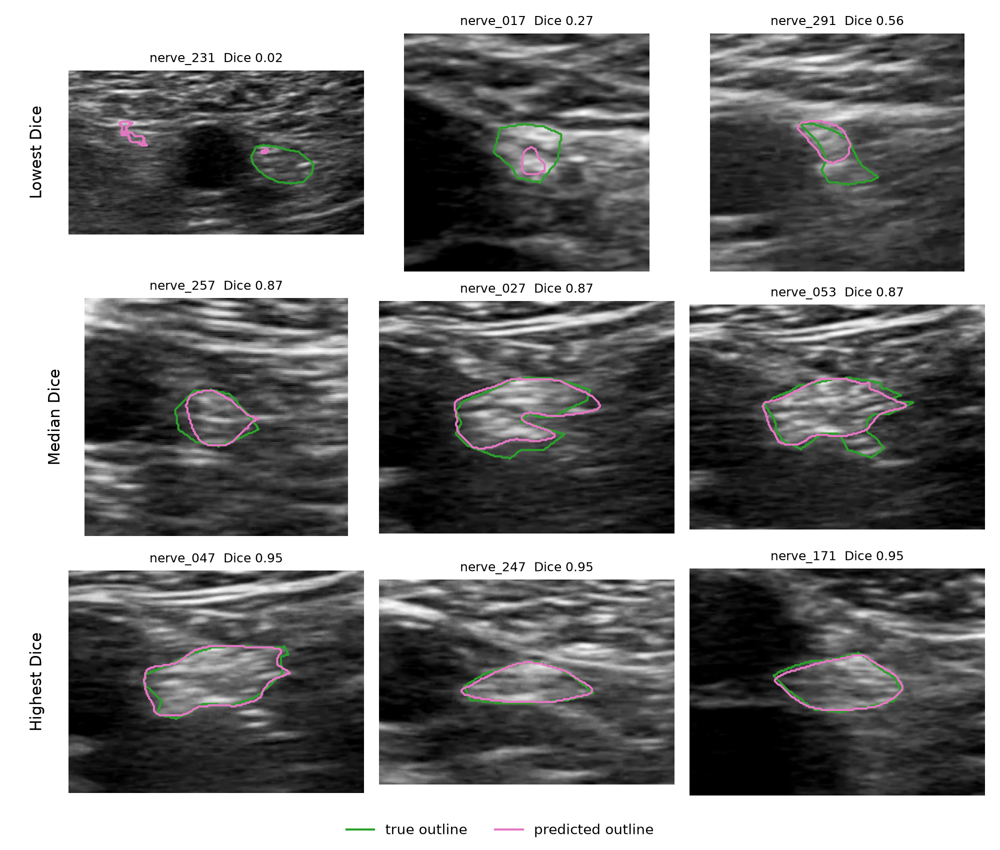
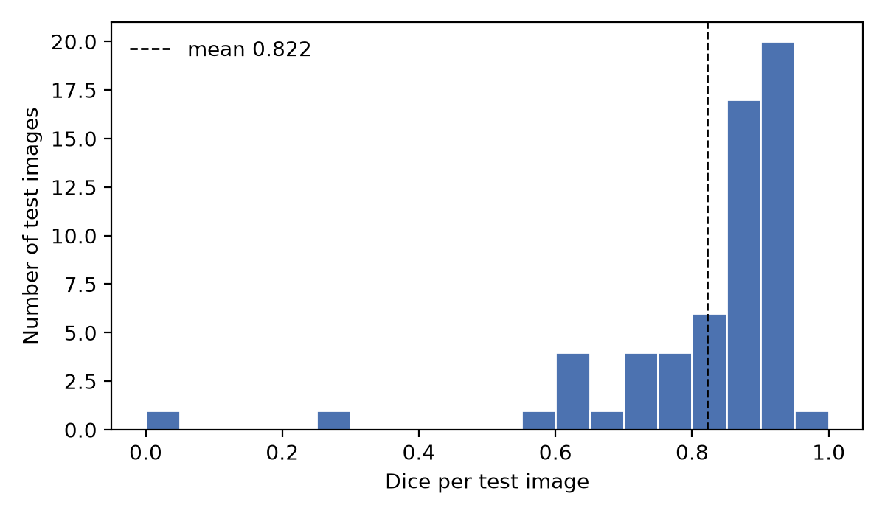
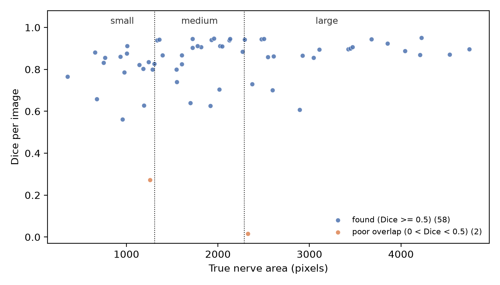
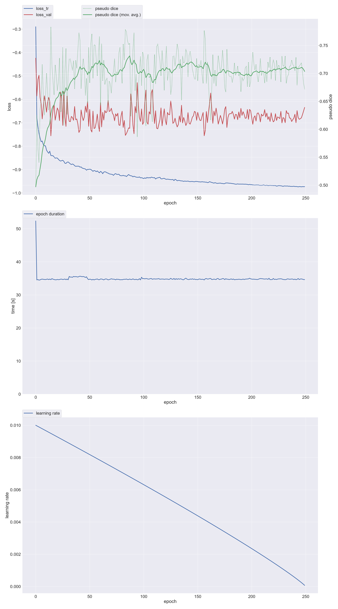
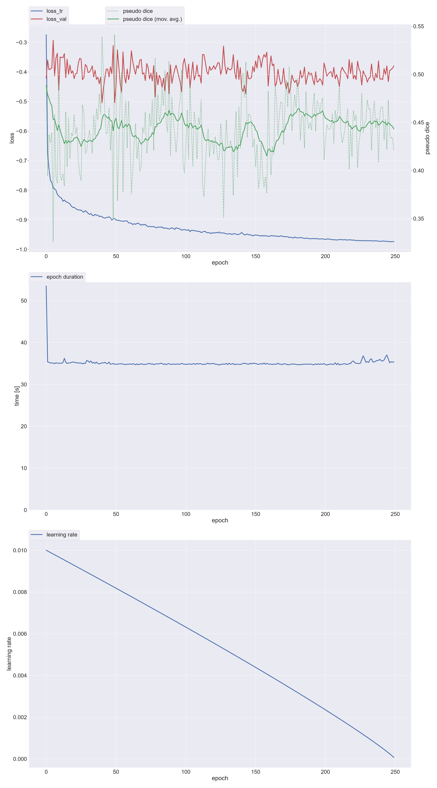
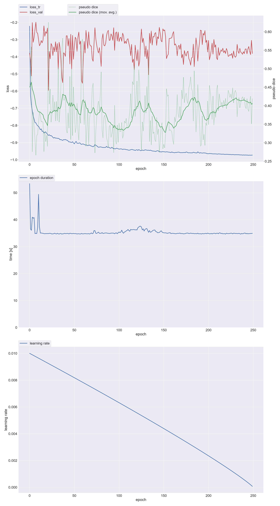
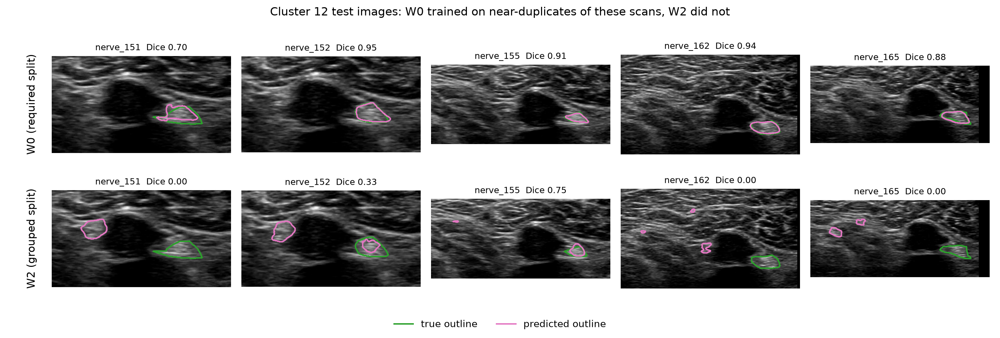
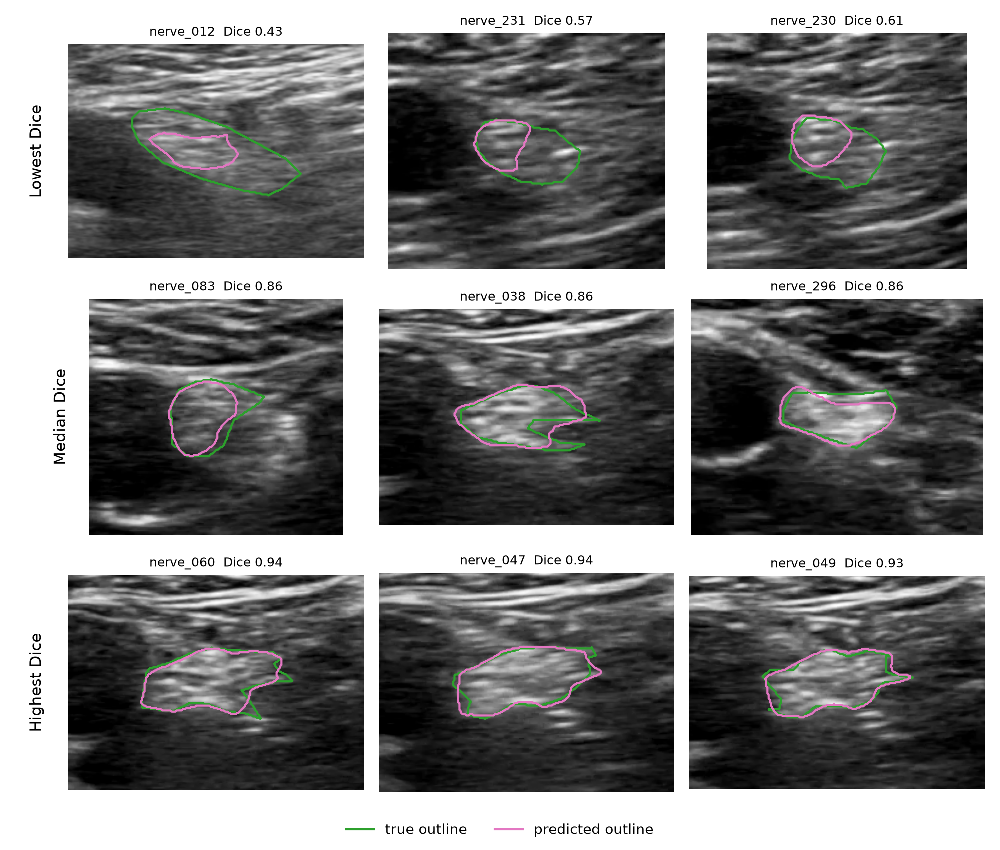
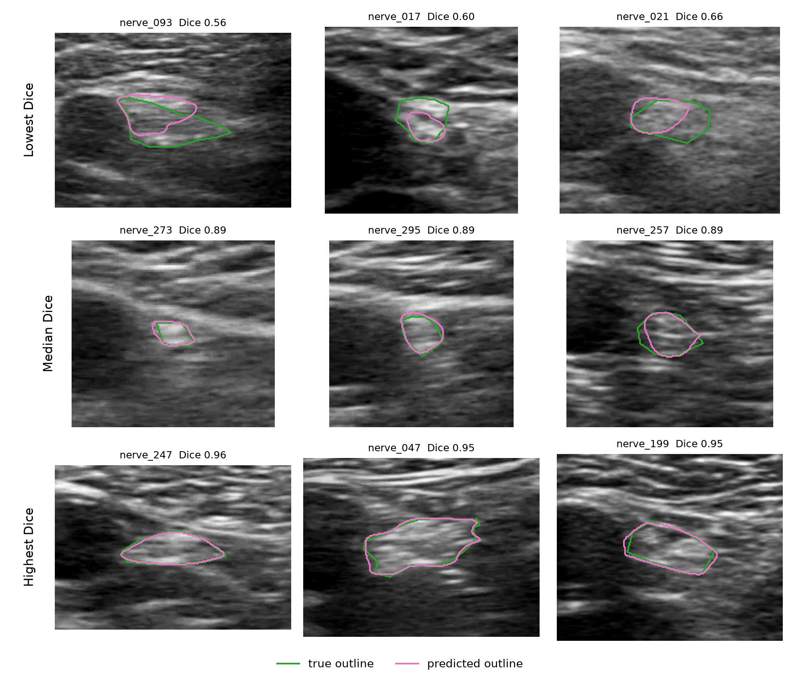
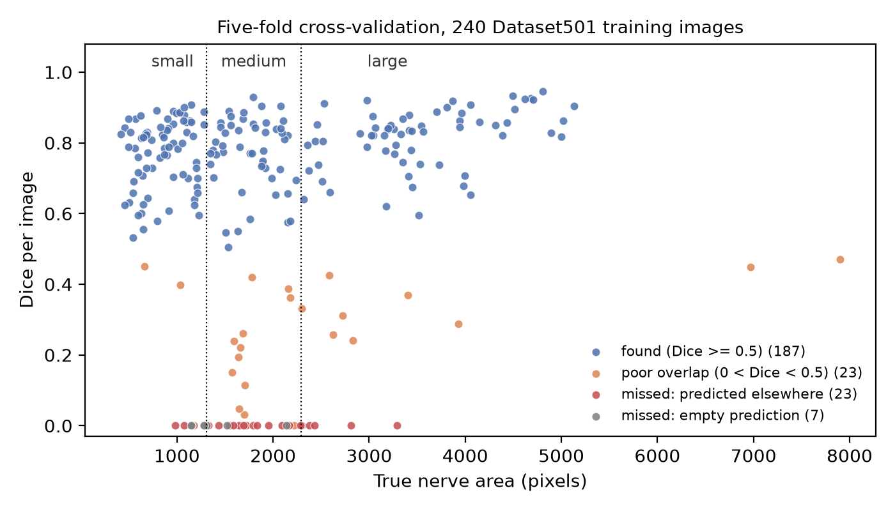

# Results synthesis for the report and slides

Written 8 Nov 2026, after every workstation run finished. This file collects the results, what they mean, and what each figure shows, arranged by the report form's sections. The rules behind each decision and the history are in `PLAN.md`; the raw numbers are in `docs/results/workstation/`. If a number here and a record disagree, the record wins.

How to read the numbers:
- Dice is computed per image, then averaged. "CI" is the 95% bootstrap interval.
- "By cluster" means the bootstrap resamples whole clusters of near-duplicate images instead of single images. Images in one cluster are nearly the same scan, so this interval is wider and fairer.
- "Post hoc" marks an analysis chosen after seeing the results. It describes the results; it never changed a decision.

Runs (all 2D nnU-Net, 250 epochs, fold 0 unless stated, all on the NVIDIA workstation):

| Name | What | Split |
|---|---|---|
| W0 | default nnU-Net, the main result | 501, the required 80/20 split |
| WB | option B: ResEnc M, nnU-Net's bigger residual-encoder network | 501 |
| WA | option A: ultrasound-aware augmentation (rotation up to 15 degrees, left-right flips only) | 501 |
| WC | option C: W0 plus folds 1 to 4; the 5 models averaged on test, and 5-fold cross-validation | 501 |
| W2 | default nnU-Net | 502, our split that keeps near-duplicate clusters together |
| WA2 | option A | 502 |

## The story in five points

For the introduction, the conclusion and slide 12.

1. **Main result.** W0 scores mean Dice 0.8224 (CI 0.7779 to 0.8599) on the 60 test images. Median 0.8682; 58 images found, 2 poor, none missed.
2. **That number is flattered by near-duplicates.** 43 of the 60 test images have a near-identical image among the 240 training images. W0 scores 0.8799 on test images from clusters it trained on (n=40) and 0.7074 on clusters it never trained on (n=20, post hoc). Five-fold cross-validation, where no cluster is shared between training and validation, gives 0.6379.
3. **Same scans, two models.** On test images neither 502 model trained on, W0 beats W2 on all 16 whose cluster W0 trained on (+0.2474, CI by cluster +0.041 to +0.537, post hoc). On cluster 12, W2 outlines a structure on the other side of the dark oval beside the nerve, where W0 finds the nerve (figure in 4.4).
4. **Baseline vs improved.** Neither option A nor option B raised validation Dice, so W0 stays. The five-fold ensemble scores 0.8539 on test (+0.0315 over W0), but about three quarters of that gain comes from 11 images whose cluster four of the five models trained on and W0 did not.
5. **Overfitting was monitored and limited, not avoided.** Training loss reaches -0.97 in every fold. The gap to validation depends on which scans were held out, not on training length. The limit is the data: 300 images in 53 clusters.

## 1. Dataset (report section 1, slides 2 and 3)

Facts (README "Dataset facts", `data/dataset_report.json`):
- 300 ultrasound images, 864 x 648, one nerve outline each. Each image is cropped to the scan area (median 544 x 736) to remove the patient header.
- The nerve covers a median 0.31% of the image (0.06% to 1.4%). Outlines are rough (5 to 39 points). 14 annotation files name the wrong image file; images and labels are paired by number.
- Near-duplicates: 212 of 300 images have a near-identical image (pixel correlation above 0.95). Chaining images whose correlation is above 0.80 gives 53 clusters, 25 of them single images; the largest hold 42, 40 and 22 images.

Splits:

| Split | Train | Test | Fold-0 train / validation | Note |
|---|---|---|---|---|
| 501, required (the instructor's random 80/20) | 240 | 60 | 201 / 39 (11 clusters, 16 images from cluster 38) | 43 of 60 test images have a near-identical image among the 240 training images |
| 502, grouped (ours: whole clusters on one side) | 237 | 63 | 201 / 36 (3 clusters, 22 images from cluster 12) | no cluster is shared between training and test |

On both datasets, all 5 cross-validation folds keep whole clusters together, so a validation image never shares a cluster with its model's training images.

The two test sets differ, which matters in 4.4 (`cluster_check.txt`):

| | 501 test | 502 test |
|---|---|---|
| Images, clusters | 60, 29 | 63, 11 |
| Largest cluster | 8 images | 40 images (cluster 20) |
| Nerves small / medium / large | 17 / 21 / 22 | 1 / 15 / 47 |
| Median nerve area | 1922 px | 3277 px |

Preprocessing (`docs/nnunet_facts.md`):
- Intensity: z-score per image. Spacing 1 x 1 (PNG has no physical spacing). No resizing beyond the crop: nnU-Net's 640 x 768 patch holds the whole image, padded.
- Augmentation during training (nnU-Net default): rotation up to 180 degrees (probability 0.2), scaling 0.7 to 1.4, Gaussian noise and blur, brightness, contrast, simulated low resolution, gamma, and flips on both axes. Elastic deformation is off. Option A changes only rotation (up to 15 degrees) and flips (left-right only).

## 2. Results that support the model section (report section 2, slides 5 to 7)

Section 2 is about nnU-Net itself. These experiment results can be cited there.
- **A bigger network gave no measurable gain.** ResEnc M (WB) against the default: validation -0.0018 (CI -0.0706 to +0.0784), test +0.0074 (CI -0.0140 to +0.0360), at 1.7 times the time per epoch (58.5 s vs 34.7 s). One run cannot prove the nnU-Net paper's claim that configuration matters more than architecture, but it agrees with it. On our data ResEnc M's patch (448 x 576) is smaller than the image, so it no longer sees the whole image at once.
- **Test-time flip averaging (nnU-Net's default) helps the default trainer.** Turning it off lowers validation Dice by 0.0452 for W0 (CI -0.0753 to -0.0198) and by 0.0262 for WB (CI -0.0463 to -0.0086). For WA, which trains with left-right flips only, it hurts: off is +0.0388 (CI +0.0185 to +0.0623), so WA's chosen setting is off (`flip_views_check.txt` confirms the trainer flips the axis it should).
- **The model uses context, and context can mislead it.** Many of the worst failures pick a bright structure on the other side of the dark oval beside the nerve (4.5). The network looks at the surroundings, not only at the nerve's texture; that supports the outline's point that the whole image fits in one patch. It also shows where this fails.
- The configuration nnU-Net chose for our data (patch, batch size 7, 8-stage network, no dropout) is in `docs/nnunet_facts.md`. No pretrained weights: nnU-Net trains from scratch.

## 3. Experimental design (report section 3, slide 8)

### Training strategy

| Setting | Value |
|---|---|
| Configuration | 2D, fold 0 of 5 (every run except WC, which trains all 5 folds) |
| Epochs | 250 (nnU-Net's default is 1000; chosen 4 Nov, when training was planned on a Mac), 250 iterations each, batch size 7 |
| Loss | soft Dice plus cross-entropy, weighted 1:1, with deep supervision (6 resolutions contribute) |
| Optimizer | SGD, Nesterov momentum 0.99, weight decay 3e-5 |
| Learning rate | 0.01, polynomial decay (exponent 0.9) to 0 at the last epoch |
| Checkpoint used | final (nnU-Net's default). `checkpoint_best` is reported only as overfitting evidence |
| Time | about 35 s per epoch, about 2.5 h per run on the RTX 4090. WB 58.5 s per epoch |

### Metrics
- Main metric: Dice per image. Also IoU. Reported as the mean with a 95% bootstrap CI, plus median and minimum.
- Failure types: found (Dice at least 0.5); poor (Dice above 0 and below 0.5); missed, with the prediction elsewhere; missed, with an empty prediction.
- Dice by nerve size, in thirds over all 300 images (below 1308 px, 1308 to 2289 px, above), with Spearman rho.
- On 501: Dice for the 43 test images with a near-identical image among the 240 training images, and for the 17 without one.
- Comparisons are paired (same images), with a bootstrap CI of the difference. Added after the results: the same CIs resampling whole clusters.

### Decision rules (fixed before any result)
- Choices are made on the fold-0 validation images only (501: 39, 502: 36). The test set is only reported, never used to choose.
- A change is adopted only if mean validation Dice rises. First test-time flip averaging, then keeping only the largest predicted region.
- Options A and B against the default: the same rule, at default inference (`run.py compare`).
- The ensemble (C) has no untouched validation images, so the rule cannot choose it. It is reported on test next to W0.

### How overfitting was monitored and limited (the form asks "how you avoided overfitting")

What limits it in nnU-Net's defaults: data augmentation on every training batch (list in section 1) and weight decay. There is no dropout and no early stopping; training always runs all epochs.

What we did to watch it: training curves for every run; best vs final checkpoint on test; five-fold cross-validation; a second split (502) that keeps near-duplicates apart.

What it showed (`cv_check.txt`):

| Fold | Train loss (last 10 epochs) | Validation loss | Gap | EMA pseudo Dice: peak (epoch), last | Validation Dice |
|---|---|---|---|---|---|
| 0 (W0) | -0.973 | -0.668 | 0.304 | 0.7314 (88), 0.7035 | 0.7244 |
| 1 | -0.974 | -0.573 | 0.401 | 0.6138 (240), 0.6075 | 0.5876 |
| 2 | -0.973 | -0.668 | 0.304 | 0.7173 (228), 0.7038 | 0.7232 |
| 3 | -0.975 | -0.773 | 0.202 | 0.8093 (141), 0.8016 | 0.7585 |
| 4 | -0.973 | -0.402 | 0.572 | 0.4885 (1), 0.4432 | 0.4156 |

Best minus final checkpoint, on test (`*_variants.csv`):

| Run | Difference | CI |
|---|---|---|
| W0 | +0.0172 | -0.0059 to +0.0488 |
| WB | -0.0026 | -0.0098 to +0.0042 |
| WA | +0.0111 | +0.0021 to +0.0239 |
| W2 | -0.0909 | -0.1238 to -0.0609 (best checkpoint from epoch 3) |
| WA2 | +0.0119 | +0.0025 to +0.0229 |

Conclusion for the report:
- Every model fits its training images almost perfectly (training loss near -0.97). The gap to validation ranges from 0.20 to 0.57, and it depends on which clusters were held out, not on how long training ran.
- Validation scores level off; they do not fall. Stopping earlier would gain at most a point or two, and it cost W2 9 points.
- Neither option A (validation -0.0567) nor option B (-0.0018) raised validation Dice, and both CIs include 0.
- So: overfitting was monitored and limited, not avoided. The remedy is more independent scans, which this fixed dataset does not have.
- Do not present option A as an overfitting control: it is less augmentation than the default, not more.
- nnU-Net's "pseudo Dice" in the curves is computed on patches during training, without flip averaging; early values are noisy. It is not the Dice we report.

## 4. Results (report section 4, slides 9 to 11)

### 4.1 All runs (slide 9)

| Run | Validation (fold 0) | Test, default inference | Chosen inference | Test, chosen |
|---|---|---|---|---|
| **W0** | 0.7244 (0.6476 to 0.7866) | **0.8224 (0.7779 to 0.8599)** | default | 0.8224 |
| WB | 0.7226 (0.6636 to 0.7740) | 0.8298 (0.7937 to 0.8633) | largest region only (validation 0.7618) | 0.8352 (0.8000 to 0.8673) |
| WA | 0.6677 (0.6023 to 0.7277) | 0.8126 (0.7709 to 0.8505) | flip averaging off (validation 0.7065) | 0.8218 (0.7875 to 0.8541) |
| WC ensemble | none; cross-validation 0.6379 (0.6001 to 0.6752) | 0.8539 (0.8291 to 0.8774) | default | 0.8539 |
| W2 | 0.4566 (0.3288 to 0.5775) | 0.8342 (0.8094 to 0.8564) | default | 0.8342 |
| WA2 | 0.4107 (0.2959 to 0.5243) | 0.7657 (0.7190 to 0.8065) | default | 0.7657 |

Compare runs only within one split: the 501 and 502 test sets are different images (section 1, and 4.4).

On test, at default inference:

| Run | Found / poor / missed | Median | Minimum | Small / medium / large nerves | More than one predicted region |
|---|---|---|---|---|---|
| W0 | 58 / 2 / 0 | 0.8682 | 0.0153 | 0.7634 / 0.8616 / 0.8305 | 6 |
| WB | 59 / 1 / 0 | 0.8857 | 0.2510 | 0.7584 / 0.8552 / 0.8606 | 7 |
| WA | 58 / 2 / 0 | 0.8702 | 0.0885 | 0.7111 / 0.8568 / 0.8487 | 9 |
| WC | 60 / 0 / 0 | 0.8894 | 0.5594 | 0.8213 / 0.8624 / 0.8709 | 1 |
| W2 | 62 / 1 / 0 | 0.8616 | 0.4280 | 0.7150 / 0.8059 / 0.8458 (1 / 15 / 47 images) | 9 |
| WA2 | 57 / 6 / 0 | 0.8356 | 0.2618 | 0.5779 / 0.7175 / 0.7851 | 19 |

W0: true nerve area against Dice, Spearman rho 0.370 (p = 0.0037, n = 60). Smaller nerves score lower.

### 4.2 Inference choices (validation decides, test reports)

| Run | Flip averaging off: validation difference (CI) | Decision | Largest region only: validation difference (CI) | Decision |
|---|---|---|---|---|
| W0 | -0.0452 (-0.0753 to -0.0198) | keep on | -0.0032 (-0.0263 to +0.0173) | no |
| WB | -0.0262 (-0.0463 to -0.0086) | keep on | +0.0392 (+0.0003 to +0.0774) | yes |
| WA | +0.0388 (+0.0185 to +0.0623) | turn off | -0.0135 (-0.0574 to +0.0235) | no |
| W2 | -0.0193 (-0.0509 to +0.0020) | keep on | -0.0200 (-0.0507 to +0.0052) | no |
| WA2 | -0.0364 (-0.0636 to -0.0127) | keep on | -0.0246 (-0.0595 to +0.0053) | no |

On test, the same changes moved mean Dice by less than 0.01, except flip averaging off for WA2 (-0.0236). The choices matter little next to the differences between scans.

### 4.3 Baseline vs improved (slide 11)

| Comparison | Validation difference (CI) | Decision | Test difference (CI by image) |
|---|---|---|---|
| WB minus W0 | -0.0018 (-0.0706 to +0.0784) | keep W0 | +0.0074 (-0.0140 to +0.0360) |
| WA minus W0 | -0.0567 (-0.1496 to +0.0387) | keep W0 | -0.0098 (-0.0443 to +0.0244) |
| WA2 minus W2 | -0.0459 (-0.1302 to +0.0366) | keep W2 | -0.0685 (-0.1096 to -0.0340) |
| WC minus W0 | not applicable | reported, not chosen | +0.0315 (+0.0075 to +0.0643); by cluster +0.007 to +0.072 |

- **Option A** is less augmentation than the default. It also changes test-time flips, so `test-variants` compares both models with flip averaging off. Then A minus default on test is +0.0044 on 501 (CI by cluster -0.025 to +0.042) and -0.0891 on 502 (CI by cluster -0.365 to -0.014). A costs more on the grouped split, where test scans have no near-duplicates in training. One run each, so this suggests rather than shows that near-duplicates hide the cost of less augmentation.
- **Option B** costs 1.7 times the training time for no measurable gain.
- **Option C, the ensemble,** splits by where each test image's cluster sits (post hoc, `cv_check.txt`):

| Who trained on the test image's cluster | Images (clusters) | Ensemble minus W0 | CI by cluster |
|---|---|---|---|
| 4 of 5 models, W0 among them | 40 (14) | +0.0030 | -0.002 to +0.007 |
| 4 of 5 models, not W0 (cluster only in fold 0's validation) | 11 (6) | +0.1282 | +0.047 to +0.333 |
| no model | 9 (9) | +0.0398 | -0.040 to +0.128 |

  Most of the gain comes from the middle row: four of the five models had seen near-duplicates of those test images and W0 had not. The ensemble does remove the worst failures: minimum 0.5594 vs 0.0153, and one image with more than one predicted region vs six. The largest single gain is nerve_231 (0.015 to 0.779), whose cluster 25 W0 never trained on.

### 4.4 Leakage: the required split vs the grouped split (slide 11)

1. **Do not compare the two test means.** W2 0.8342 vs W0 0.8224 is not a leakage effect: the test sets are different images (section 1). Counting each cluster once, W2 scores 0.7457 and W0 0.7877.
2. **W2's low validation score (0.4566) comes mostly from one cluster.** Of its 36 validation images, 22 are from cluster 12 (Dice 0.220, 12 at zero); cluster 9 (13 images) scores 0.832 and cluster 50 (1 image) 0.768.
3. **Same images, two models (post hoc).** These are the 21 test images of 501 that the 502 models did not train on, split by whether fold 0 of 501 trained on the image's cluster:

| Pair | Cluster trained on by the 501 model | Difference, median | CI by cluster | Better |
|---|---|---|---|---|
| W0 minus W2 | yes: n=16, 6 clusters; 0.9040 vs 0.6567 | +0.2474, +0.0491 | +0.041 to +0.537 | W0 on all 16 |
| W0 minus W2 | no: n=5; 0.5071 vs 0.6842 | -0.1772, -0.0879 | -0.427 to +0.062 | W2 on 4 |
| WA minus WA2 | yes: n=16; 0.9070 vs 0.5778 | +0.3292, +0.1002 | +0.086 to +0.642 | WA on all 16 |
| WA minus WA2 | no: n=5; 0.6698 vs 0.6535 | +0.0163, +0.0359 | -0.065 to +0.088 | WA on 3 |

   The model wins clearly when it has seen near-duplicates of the scan, and not otherwise. Two pairs of models show the same pattern.
4. **W0 on its own test set (post hoc).** Test images from clusters it trained on: 0.8799 (n=40, CI by cluster 0.866 to 0.899). Clusters it never trained on: 0.7074 (n=20, CI by cluster 0.592 to 0.792). These are different images, so this suggests the size of the effect rather than measuring it.
5. **Cross-validation** with no shared cluster: 0.6379 (CI by cluster 0.491 to 0.750).

Suggested sentence: "On the required split, part of nnU-Net's 0.82 test Dice comes from near-duplicate scans seen in training: on scans whose cluster it never saw, it scores about 0.71 on test and 0.64 in cross-validation."

Wording: the 43 test images have a near-identical image "among the 240 training images", not "in W0's training". W0 trained on 201 of them, so 10 of the 43 have their twin only in fold 0's validation images (W0 0.7149 on those 10, 0.8830 on the other 33).

### 4.5 Successes and failures (slide 10)

Successes: most test images score between 0.85 and 0.95 (37 of 60 for W0). Where they fall short of 1, the difference sits at thin protrusions and notches of the rough hand-drawn outline.

Failure patterns, seen in the figures (section 5) and checked against the numbers:
1. **Wrong structure beside the dark oval.** The model outlines a bright structure on the other side of the dark oval. Examples: nerve_231 for W0 (Dice 0.015); nerve_273 for WA (0.39, which also outlines the true nerve); most cluster 12 images for W2; clusters 12 and 2 in cross-validation.
2. **Under-segmentation.** The model outlines only part of the nerve, usually the brighter or upper part of an elongated or two-part outline. Examples: nerve_017, nerve_291 and nerve_093 for W0, WB and the ensemble; nerve_012, nerve_230 and nerve_231 for W2.
3. **Fragments.** Several small pieces instead of one region. Mostly WA2 (19 of 63 test images have more than one region, against 9 for W2).
4. **Nothing found.** Only in cross-validation: cluster 14, all 12 images.

The same images are hard for every model: nerve_017 (no near-duplicate; 0.25 to 0.60 across W0, WB, WA and the ensemble) and nerve_093 (cluster 2; 0.53 to 0.61). That points to the images, and perhaps their outlines, rather than to one model.

Cross-validation failures concentrate in three clusters (post hoc, `cv_check.txt`). Clusters 14, 12 and 2 hold 42 of the 240 images and 26 of the 30 zero-Dice images; the other 198 images score 0.7471.
- Cluster 14 (12 images, all Dice 0): the only scans with a narrow view, where 443 image columns hold ultrasound against a median of 722. The model finds nothing, or tiny fragments.
- Cluster 12 (17 images in fold 1: 0.129; 22 in W2's validation: 0.220): it fails in two models trained on different images, with the prediction on the other side of the dark oval.
- Cluster 2 (13 images, 0.228): the same wrong-side pattern in several images.
- Nerve position explains little. Images whose nerve sits at least 2 standard deviations from the training mean score 0.367 (n=25), but with one point per cluster, Spearman rho is -0.074 (p = 0.63), and cluster 14 sits near the mean.

### 4.6 Five-fold cross-validation, per fold

| Fold | Images | Clusters | Mean Dice | Median | Zero Dice | Lowest cluster (images) Dice |
|---|---|---|---|---|---|---|
| 0 | 39 | 11 | 0.724 | 0.816 | 2 | 25 (4) 0.225 |
| 1 | 51 | 9 | 0.588 | 0.777 | 9 | 12 (17) 0.129 |
| 2 | 50 | 8 | 0.723 | 0.769 | 1 | 32 (2) 0.396 |
| 3 | 50 | 8 | 0.758 | 0.837 | 1 | 45 (7) 0.518 |
| 4 | 50 | 8 | 0.416 | 0.518 | 17 | 14 (12) 0.000; 2 (13) 0.228 |

Mean of the 5 fold means 0.6419 (SD 0.1425); all 240 images together 0.6379. Without clusters 12, 14 and 2 (post hoc): fold 1 0.8170, fold 4 0.7125.

## 5. What the figures show

All figures are in `figures/` and use the cropped images (no patient details). Outlines: true in green, predicted in magenta. Case figures show the 3 lowest, 3 median and 3 highest test images. Each run's figures use its chosen inference setting (WB: largest region only; WA: flip averaging off).

### Main result (slides 9 and 10)

`workstation_501_default_cases_zoom.png` (and `_full.png`, the uncropped version). W0 on test.
- Highest (0.95): smooth, compact nerves; the two outlines nearly coincide.
- Median (0.87): the shape is right; the difference sits at notches and thin protrusions of the true outline. Dice around 0.87 is close to what rough outlines allow.
- Lowest: three different failures. nerve_231 (0.02) is the wrong-structure failure: the outline sits on the other side of the dark oval. W0 never trained on this scan's cluster. nerve_017 (0.27) has no near-duplicate; the model outlines a small part inside the nerve. nerve_291 (0.56): the true outline has two parts, and the model takes only the upper one.
- Message: when W0 finds the nerve, it outlines it well. Its errors are about which structure to pick, or how much of it.

`workstation_501_default_dice_hist.png`. Most images sit between 0.85 and 0.95 (37 of 60); 8 are below 0.7. Two outliers (0.015 and 0.27) pull the mean (0.822) below the median (0.868). Report the median and minimum next to the mean.

`workstation_501_default_size.png`. Dice against true nerve area, coloured by failure type. Large nerves are found consistently (most between 0.85 and 0.95). Small nerves spread more widely (0.56 to 0.91 among those found). The two poor images are one small nerve (nerve_017) and one large nerve (nerve_231), so size alone does not explain the failures. Spearman rho 0.370.

### Training curves (slide 8)

`workstation_501_nnUNetTrainer_250epochs_fold0_progress.png`. Top panel: losses and pseudo Dice; middle: seconds per epoch; bottom: learning rate.
- Training loss (blue) falls steadily, to -0.97.
- Validation loss (red) falls quickly for about 15 epochs (lowest -0.756 at epoch 15), then stays level with spikes; the last epochs drift slightly up.
- The pseudo Dice average (green) reaches about 0.70 by epoch 40, peaks at 0.73 around epoch 88, and then stays near 0.70.
- Message: the model keeps fitting the training images while validation stays flat. That is the overfitting gap, but there is no late collapse that earlier stopping would fix.

Folds 1 to 4 (`..._fold1_progress.png` to `..._fold4_progress.png`). Training loss looks the same in every fold; validation differs. Fold 4 (above) is the extreme: validation loss stays flat from epoch 0 near -0.40, and pseudo Dice never beats its epoch-1 value. Show folds 0 and 4 side by side: same training, very different held-out scans.

`workstation_502_nnUNetTrainer_250epochs_fold0_progress.png` (W2). Like fold 4: validation loss hardly improves, and pseudo Dice peaks in the first epochs, which is why W2's "best" checkpoint is from epoch 3. Its validation is 22 images from cluster 12, which W2 cannot segment. The curve shows the held-out scans, not a training failure.

### Leakage (slide 11)

`workstation_501_502_cluster12_W0_vs_W2.png`. The five cluster-12 test images that neither 502 model trained on. Top row W0, which trained on near-duplicates of these scans (Dice 0.70 to 0.95). Bottom row W2, which did not (0.00, 0.33, 0.75, 0.00, 0.00). In nerve_151 and nerve_152, W2 outlines a bright structure on the other side of the dark oval; in nerve_162 and nerve_165 it marks scattered patches. Message: on a scan it has seen before, the model finds the nerve; on a new scan of the same kind, it can pick the wrong structure. This is what a near-duplicate in training is worth. Five images from one cluster: show it as an illustration next to the numbers in 4.4, not as proof.

`workstation_502_default_cases_zoom.png` (and `_size.png`, `_dice_hist.png`). W2 on its own test set. The lowest three are under-segmentations (0.43 to 0.61): the model outlines one end of an elongated nerve. None picks the wrong structure. Its size plot: almost every nerve is medium or large, and the one poor image is the largest nerve (about 7000 px, Dice 0.43). Message: 502's test set is easier (larger nerves, 40 of 63 images from one cluster that W2 handles well), which is why its test mean cannot be compared with W0's.

### Baseline vs improved (slide 11)

`workstation_501_resenc_*` (WB). The lowest three are under-segmentations of the same images W0 finds hard (nerve_017 0.25, nerve_291 0.53, nerve_093 0.53); there is no wrong-structure failure among them. The median and highest look like W0's. Message: a bigger network does not fix the hard images.

`workstation_501_usaug_*` (WA). Lowest: nerve_273 (0.39) outlines the true nerve and also a second region on the other side of the dark oval; nerve_017 (0.47) and nerve_265 (0.51) are under-segmented. The histogram (mean 0.822) matches W0's.

`workstation_502_usaug_*` (WA2). The lowest three (0.26 to 0.31) are fragmented: ragged pieces inside the nerve, plus small blobs on the other side of the dark oval in nerve_171 and nerve_169. Message: with less augmentation and no near-duplicates to lean on, the model's outlines break up. That matches WA2's 19 images with more than one region and its -0.0685 on test.

`workstation_501_ensemble_cases_zoom.png` (and `_size.png`, `_dice_hist.png`). The five-fold ensemble on test. Every image is found; the lowest is 0.56. The lowest three are under-segmentations of the familiar hard images (nerve_093 0.56, nerve_017 0.60, nerve_021 0.66). nerve_231 is no longer among them (0.779). In the size plot, no point is below 0.5. Message: averaging removes the wrong-structure failures. Section 4.3 shows, though, that much of the gain comes from models that saw the test image's cluster.

### Cross-validation (slides 8 and 10)

`workstation_501_cv_size.png`. All 240 training images, each predicted by the model that did not train on it. The picture is much harsher than on test: 30 images at Dice 0, 23 poor, 187 found. Most zeros are medium-sized nerves (17 of 30, 12 of them from clusters 12 and 14). Without clusters 12, 14 and 2, medium nerves still score lowest (0.6995, against 0.76 to 0.77 for small and large). Message: this is the honest picture for scans the model has never seen. The failures are mostly whole clusters, not single images.

## Limitations (report and slide 12)
- One fold (fold 0) per run, except WC. One training run (one random seed) per setting, so differences below about 0.02 may be noise.
- 250 epochs: a quarter of nnU-Net's default 1000.
- The validation sets are small and clustered: 39 images from 11 clusters (501), 36 from 3 (502). Validation decisions lean on a few clusters.
- Several analyses were chosen after seeing the results (marked post hoc). They describe the results; they did not change any decision.
- The test set appears in many reported comparisons, but no choice was made on it.
- Option A changes the training augmentation and the test-time flips together; `test-variants` separates the two.
- Hardware: C's fold 3 crashed once, after its training had finished (suspected CPU instability). The queue's retry ran validation only. Re-predicting 160 images with the saved models reproduced the saved masks to within 3 pixels per image (`repredict_check.txt`).

## Avoid writing these
- "W2 vs W0 on test shows the leakage effect." The test sets differ (4.4).
- "The 43 test images have a near-duplicate in W0's training." They have one among the 240 training images; for 10 of them, the twin is only in fold 0's validation images.
- "Ensembling improved Dice by 0.03 because averaging reduces variance." Most of the gain comes from models that saw more near-duplicates (4.3).
- "Ultrasound-aware augmentation (option A) controlled overfitting." It is less augmentation, and it did not help.
- "We avoided overfitting." It was monitored and limited.
- Citing pseudo Dice from the training curves as a result. It is patch-based, without flip averaging, and noisy.

## Open questions (hypotheses, not results)
- Wrong-structure failures: every trainer here flips images left-right during training, so orientation alone cannot tell a model which side of the dark oval the nerve sits on. Not tested.
- Cluster 14's narrow view may come from a different scanner setting. That is one cluster, and it was not tested.

## Where the numbers come from

All paths are under `docs/results/workstation/`.

| What | File |
|---|---|
| Per-run validation decisions | `<run>_selection.json` |
| Per-run test variants (flips, clean-up, best checkpoint) | `<run>_variants.csv` |
| Baseline vs improved | `compare__*.json` |
| Ensemble and cross-validation | `*_folds01234_ensemble.json`, `*_cv_folds01234_dice.csv`, `cv_check.txt` |
| Clusters, test-set differences, same-image comparison | `cluster_check.txt`; the stricter split is in `cv_check.txt` |
| Option A's flips | `flip_views_check.txt` |
| Reproducibility after the crash | `repredict_check.txt` |
| Training logs and curves | `logs/` |
| Per-image Dice | `*_dice.csv` |
